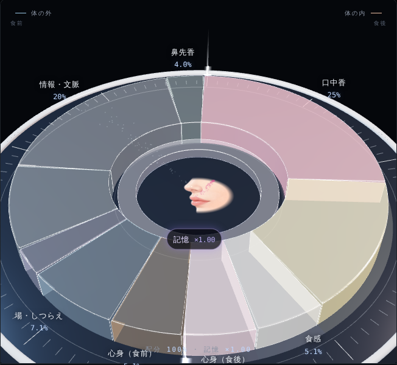

# Human Compass of Taste — Variable
### 可変五感コンパス

> The glass never changes. What changes is the bearing of the one who receives it.
> 一杯は何も変わらない。変わるのは、それを受け取る側のコンパスの向きのほうだ。

An interactive compass of how the senses share the work of making something taste good, and of how that share shifts with the scene you are in.

Pick a scene and watch the compass turn. Readers of the book can open the life scenes and the levers with the passphrase printed in it.

---

## What it is

The **Human Compass of Taste** draws flavour perception as sommelier and bartender Yoshihide Iwao has seen it from some forty years behind the counter. Ten crystal sectors stand on a dial around an inner ring of Memory. At the centre are a nose and a pair of lips: the compass draws not the glass but the person receiving it.

It looks like a pie chart at first glance. It is called a compass because it points to the many directions in which a person's senses turn toward the glass, and because it moves freely.

**The meridian.** A line of light runs north–south across the dial. To its left (west) sit the senses outside the body, before eating: Orthonasal, Context, Vision, Sound, Body & Setting. To its right (east) sit the senses inside the body, after eating: Retronasal, Taste, Texture. The meridian is a boundary in space and in time at once. Mind & Body State works differently before and after the first sip, so it alone sits on both sides.

**Angle and height.** The angle of each sector is its share, always summing to 100%. Its height is how strongly that sense is working compared with the default. Orthonasal and retronasal aroma are drawn as streams of light flowing to the nose, one from the glass and one from inside the mouth.

## How to use it

**The key.** Tap any row of the table "How to read the compass" and its sector lights up and rises; tap again to let it settle.

**Research scenes.** Ten scenes taken from published experiments: pinching your nose, being told the price, dimming the lights, eating in a restaurant, thickening a sauce, the day your team won, hunger, cabin noise, swirling the glass, growing older. Each moves the compass in the direction the research reports.

**Life scenes (readers only).** Eight scenes from life, with no literature behind them: the barbecue, the late-night ramen, a first date, dinner on the boss, miso soup after a hangover, cup noodles on a summit, the meal after a funeral, the final moment. Each ends with a question for you. There is no right answer. They open with the passphrase printed in the book *The Compass of Taste* (美味しさの羅針盤).

**Levers and your own scenes (readers only).** Eleven levers, one for each sector plus the Memory ring, from ×0 to ×2.5. Set them, give the scene a name and a line, and place it among your own scenes; it stays in your browser.

**Two ways of reading.** *Share* keeps the total at 100%: when one sense swells, the others shrink. *Total varies* lets the whole compass grow and contract, as if the amount of deliciousness itself had changed. Which of the two matches experience better is an open question, and the reason both are here.

**Links to a scene.** Any scene can be opened directly: `?scene=price&lang=ja`, `?scene=summit&lang=en`. Scene IDs are listed in `scenes.json`.

## What is known and what is hypothesis

The **direction** in which each sector moves in a research scene corresponds to existing research. The **default proportions**, the **size** of every movement, and the whole of the life scenes are the author's hypothesis — a reading from the field, not a measurement.

No study we know of places all ten senses on one common scale. That gap is exactly what this compass is offered into.

## References

- Cabanac, M. (1971). Physiological role of pleasure. *Science*, 173(4002), 1103–1107.
- Doty, R. L., Shaman, P., Applebaum, S. L., Giberson, R., Siksorski, L., & Rosenberg, L. (1984). Smell identification ability: changes with age. *Science*, 226(4681), 1441–1443.
- Edwards, J. S. A., Meiselman, H. L., Edwards, A., & Lesher, L. (2003). The influence of eating location on the acceptability of identically prepared foods. *Food Quality and Preference*, 14(8), 647–652.
- Hollowood, T. A., Linforth, R. S. T., & Taylor, A. J. (2002). The effect of viscosity on the perception of flavour. *Chemical Senses*, 27(7), 583–591.
- Morrot, G., Brochet, F., & Dubourdieu, D. (2001). The color of odors. *Brain and Language*, 79(2), 309–320.
- Noel, C., & Dando, R. (2015). The effect of emotional state on taste perception. *Appetite*, 95, 89–95.
- Plassmann, H., O'Doherty, J., Shiv, B., & Rangel, A. (2008). Marketing actions can modulate neural representations of experienced pleasantness. *PNAS*, 105(3), 1050–1054.
- Rozin, P. (1982). "Taste–smell confusions" and the duality of the olfactory sense. *Perception & Psychophysics*, 31(4), 397–401.
- Small, D. M., Gerber, J. C., Mak, Y. E., & Hummel, T. (2005). Differential neural responses evoked by orthonasal versus retronasal odorant perception in humans. *Neuron*, 47(4), 593–605.
- Yan, K. S., & Dando, R. (2015). A crossmodal role for audition in taste perception. *Journal of Experimental Psychology: Human Perception and Performance*, 41(3), 590–596.

## Files

| File | What it holds |
| --- | --- |
| `index.html` | The whole compass: page, styles, and the WebGL scene. |
| `scenes.json` | The scene book. Research scenes in full; life scenes by name only. |
| `life.enc.json` | The life scenes, sealed (AES-GCM). The passphrase in the book opens them in the browser. |
| `tools/seal.py` | Seals a private file of life scenes into `life.enc.json`. The private file is never committed. |
| `assets/preview.png` | The image above. |

`index.html` loads three.js r128 from a CDN and fonts from Google Fonts; there is no build step. Serve the repository with GitHub Pages. Because the page reads `scenes.json` over HTTP, opening the file directly from disk falls back to the scenes built into the page.

## Related work

- **3DCC — The 3-Dimensional Cognitive Coordinate.** A WebGL map of cocktails in a three-dimensional taste space. [Special Kudos, CSS Design Awards 2026](https://www.cssdesignawards.com/sites/3dcc/50155/).
- **FBC — Food & Beverage Coordinate System.** A seven-axis pairing tool, at [cocktailtheory.github.io](https://cocktailtheory.github.io).
- ***The Compass of Deliciousness* (美味しさの羅針盤).** A book on the neuroscience of deliciousness, written from behind the counter. The compass figures in the book open this page.
- **Beyond the Glass** on [note](https://note.com/beyondtheglass).

---

## 日本語

美味しさを生み出すために、五感がどのように仕事を分け合っているか。そしてその配分が、場面によってどう揺らぐか。それを手で触って確かめられるコンパスです。

### これは何か

五感コンパスは、ソムリエでありバーテンダーである岩尾良英が、およそ四十年カウンターに立って見てきた美味しさの構造を描いたものです。十の結晶の扇が記憶の環を囲み、中心には鼻と唇が置かれています。描かれているのはグラスの中身ではなく、それを受け取る人の側です。

ひと目には円グラフですが「羅針盤（コンパス）」としたのは、グラスに向かう人の感覚の向きを様々に指し示し、自在に動くことによります。

**子午線。** 文字盤を南北に一本の光の線が貫いています。左（西）は体の外、食べる前の感覚で、鼻先香・情報と文脈・視覚・音・場としつらえ。右（東）は体の内、食べた後の感覚で、口中香・味覚・食感。子午線は空間の境であると同時に時間の境でもあります。心身の状態は食前と食後で働きが違うため、ただひとつ両側に分けて置いています。

**角度と高さ。** 扇の角度は配分で、全体で100%になります。扇の高さは基準からの強まりです。鼻先香と口中香は、グラスから、そして口の中から鼻へ流れる光の粒として描いています。

### 使い方

「この羅針盤の読み方」の表の行を押すと、その扇が光って立ち上がります。もう一度押すと戻ります。

研究の場面は、既存の実験にもとづく十の場面です。鼻をつまむ、値段を告げる、照明を落とす、店で食べる、とろみをつける、勝った日、空腹、機内の騒音、グラスを回す、年を重ねる。研究が示す方向へコンパスが動きます。

人生の場面（読者限定）は、文献のない岩尾の見立てです。バーベキュー、締めのラーメン、初めてのデート、上司のおごり、二日酔いの味噌汁、山頂のカップ麺、お葬式の精進落とし、今際の際。それぞれの場面の最後に、あなたへの問いがあります。正解はありません。書籍『美味しさの羅針盤』の中にある合言葉で開きます。

レバー（読者限定）は十の扇と記憶の環の十一本で、×0から×2.5まで動かせます。配分を決めて名前と一文を添えれば、あなたの場面としてブラウザに残せます。

表示は二通りあります。「配分」では合計が100%に保たれ、誰かが膨らめば誰かが痩せます。「総量も変わる」ではコンパス全体が伸び縮みし、美味しさの大きさそのものが変わります。どちらが実感に近いかはまだ開いた問いであり、だから両方を置いています。

場面は URL で直接開けます。`?scene=price&lang=ja` のように指定してください。場面のIDは `scenes.json` にあります。

### 既知と仮説

研究の場面で各扇が動く方向は、既存の研究に対応しています。既定の配分、動く量、そして人生の場面のすべては、著者の仮説です。測定値ではなく、現場からの見立てです。

十の感覚を同じ尺度に並べた研究は、私たちの知る限りまだありません。このコンパスは、その空白に向けて差し出すものです。

### ファイル

`index.html` がコンパス本体、`scenes.json` が場面帳です。研究の場面は `scenes.json` を編集してください。人生の場面は非公開の原本を書き換え、`tools/seal.py` で `life.enc.json` に封をし直します。原本はリポジトリに入れないでください。

---

© 2026 Yoshihide Iwao. All rights reserved.
